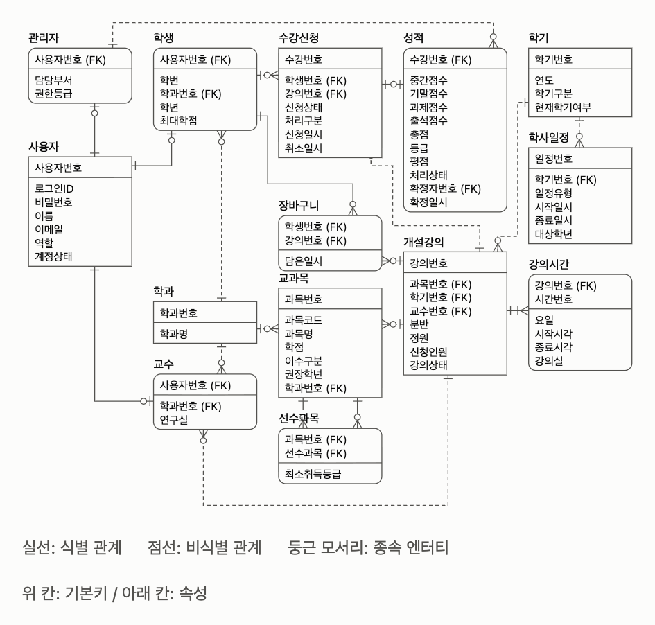

# 데이터베이스 설계 프로젝트 계획서

| 분반 | 조이름 | 조원 | 제출일 |
| --- | --- | --- | --- |
| 가 | 가람이의 뿌리를 찾아서 | 백가람, 신예은, 김효민 | 2026.11.03 |

## 프로젝트 개요서

**프로젝트명:** 수강신청 및 학생 성적관리 시스템, 관리자 페이지

### 1. 프로젝트 개요

이 프로젝트는 **수강신청, 성적관리, 학사 운영 관리를 하나의 데이터베이스로 통합**하는 웹 시스템을 설계·구현하는 것을 목표로 합니다. 사용자는 세 종류로 나눕니다.

- **학생**: 강의 검색, 장바구니, 수강신청·취소, 시간표 확인, 성적 조회
- **교수**: 담당 강의와 수강생 명단 확인, 성적 입력·수정
- **조교(선택)**: 교수와 같은 권한이나 교수가 지정 및 삭제할 수 있음
- **관리자**: 학기, 강의, 사용자 관리, 수강신청 기간 설정, 신청 현황 모니터링, 성적 확정

### 2. 주요 기능

#### ① 사용자 화면 (학생)

| 화면 | 기능 |
| --- | --- |
| 로그인 | 학번/비밀번호 로그인 |
| 강의 검색 | 학과, 학년, 이수구분, 교수명, 요일·시간으로 검색. 잔여 인원 표시 |
| 장바구니 | 신청 전에 관심 강의 담기, 예상 학점 합계 표시 |
| 수강신청 | 신청·취소. 정원 초과, 시간표 중복, 최대 학점 초과, 선수과목 미이수 시 차단 |
| 내 시간표 | 신청한 과목을 주간 시간표 형태로 표시 |
| 성적 조회 | 학기별 성적, 평점(GPA), 누적 이수 학점 |

#### ② 사용자 화면 (교수)

| 화면 | 기능 |
| --- | --- |
| 담당 강의 목록 | 학기별 담당 강의와 수강 인원 |
| 수강생 명단 | 강의별 수강생 정보 조회 |
| 성적 입력 | 중간·기말·과제·출석 점수 입력, 등급 자동 산출, 입력 기간 내 수정 |

#### ③ 관리자 화면

| 화면 | 기능 |
| --- | --- |
| 대시보드 | 학기별 개설 강의 수, 신청률, 정원 마감 강의 현황 |
| 학기·기간 관리 | 수강신청 기간, 정정 기간, 성적 입력 기간 설정 |
| 강의 관리 | 강의 개설, 수정, 폐강. 강의실·시간·정원·담당 교수 지정 |
| 사용자 관리 | 학생·교수 계정 등록, 수정, 비활성화 |
| 수강신청 현황 | 강의별 신청 인원 조회, 수동 추가·취소 처리 |
| 성적 관리 | 미입력 강의 확인, 성적 확정(확정 후 교수 수정 불가) |

### 3. 주요 엔티티 설계

실선: 식별 관계 · 점선: 비식별 관계 · 둥근 모서리: 종속 엔티티 · 위 칸: 기본키 / 아래 칸: 속성

### 4. 조장 및 조원들의 역할

| 이름 | 구분 | 담당 업무 |
| --- | --- | --- |
| 신예은 | 조장 | 업무 기능도, 단위 업무 기술서, 업무 흐름도 / 백엔드 / 발표 자료 / 개요서·최종 보고서 |
| 김효민 | 조원 | 논리적·물리적 데이터 모델, 용어 기술서 / 백엔드 / 발표 / 개요서·최종 보고서 |
| 백가람 | 조원 | 업무 문서 리스트, 도메인 정의서, 테이블 기술서 / 프론트엔드 / 발표 자료 / 개요서·최종 보고서 |

### 5. 인터뷰

#### 5.1 인터뷰 질문

1. 교수님도 수강신청 화면(강의 검색, 시간표 보기)에 들어갈 수 있어야 하나요? 들어갈 수 있다면 열람만 가능한가요?
2. 교수님은 무엇으로 로그인하나요?
3. 교수님에게 학생 정보는 언제부터 보이나요?

#### 5.2 인터뷰 답변

1. 관리자(교직원) - 학부: 유세인트 (과목을 학부에서 생성해 주면 그게 LMS에 생성됨)
2. 교수: 생성 과목만 볼 수 있음(스마트 캠퍼스) - 과목이랑 성적, 강의계획서 수정, 사용자 그룹 조정, 조교 추가(삭제도 됨), 학생 화면도 볼 수 있음, 교번으로 로그인(학생이랑 동일 로그인 창), 수강신청이 다 끝나면 접근 가능
3. 조교 권한: 교수 권한 그대로(출석 체크랑 다 됨), 교수님 삭제는 안 됨
4. 학생 - 유세인트로 신청
